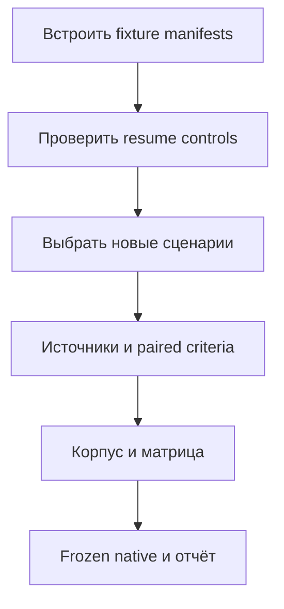

# Развитие единого скила `bsp` после локального кандидата v0.16

**Статус:** действующий план после локально проверенного v0.16 на frozen
`5f9aefe`. Тег/push/релиз v0.16 не создавались. Имя файла сохранено для ссылок.
Публикация и проверка скачанных assets — отдельный этап с отдельным разрешением.

## Историческая отправная точка v0.15

- Поставляется **один** `skills/bsp/`: короткий маршрутизатор, 24 тематических
  `references/`, скрипт `scripts/bsp_api.py`. Сторонние `.agents/skills/`
  нужны разработчикам Pi, не входят в релиз и не являются источником API БСП.
- Поставляемые пути `skills/bsp`, `install.sh`, `install.ps1` на теге v0.15
  не отличаются от проверенного кандидата `7b1abc7`. ZIP/tar.gz кандидата
  собраны дважды побайтно одинаково; проверены оба упакованных установщика,
  обновления и безопасные отказы без сети и без глобальных назначений.
- По [отчёту кандидата](../reports/bsp-skills/7b1abc7-release-candidate-readiness.md):
  191 unit tests PASS, API coverage 664/664, 24/24 references,
  semantic ERROR/WARN 0/0. Совпадение сигнатуры и региона не доказывает
  поведение метода и не является компиляцией или исполнением BSL.
- Свежие native-прогоны распакованного ZIP: smoke 1/1; guided **27/27 majority,
  78/81 individual**; activation **6/6 majority, 18/18 individual**.
  Quality/overall и isolation gates PASS, проверяемых invalid/unsafe/forbidden
  BSP calls и infrastructure failures нет. Это результаты отдельных корпусов;
  их нельзя складывать в один показатель качества.
- Guided strict reference-read — **76/78** положительных запусков, activation
  positive/read — **9/9 и 6/6**, false activation — **0/3 и 0/9** соответственно
  в guided/activation negatives. Три guided FAIL сохранены. Эти результаты
  одной выборки не доказывают отсутствие будущих stochastic ошибок.
- Самостоятельная активация покрывает **2/24 references** (`base-common.md`,
  `update.md`), а не все 24: API coverage и behavioral coverage — разные вещи.
  Корпус и матрица: `evals/activation-cases.json` и
  `evals/activation-reference-matrix.json`.

История исправлений и исходные FAIL остаются в отчётах:
[scope-before-open](../reports/bsp-skills/2c2ba52-native-discovery-verification.md),
[reference recovery](../reports/bsp-skills/p3-reference-recovery-after-p2.md),
[native runtime](../reports/bsp-skills/p0-native-runtime-loop-after-v0.14.md).
Новые PASS не меняют исторические результаты и не доказывают причинного
улучшения относительно другого профиля, модели или evaluator.

## Текущее состояние v0.16

[Полная проверка кандидата](../reports/bsp-skills/v0.16-release-candidate-readiness.md):
217 tests PASS, API 664/664, semantic 0/0; точные архивы и оба упакованных
установщика PASS. Свежий guided **27/27 majority, 81/81 individual**,
activation **10/10, 28/30**, все итоговые quality/isolation gates PASS.
Guided activation/read **78/78**, activation positive/allrefs-read **21/21
и 18/18**, false activation **0/3 и 0/9**. Один capacity failure восстановлен
в отдельной копии, 59 завершённых результатов и оба quality FAIL сохранены.
Это не публикация и не причинный эксперимент по одному изменению.

Первая P1-партия выполнена: **5/24 references**, 10 сценариев, сквозной
allrefs-read, согласованная матрица. P3 evidence-пилот выполнен для этих
рискованных правил, не для всех API. Источники и исходные FAIL доступны
в [evidence-пилоте](../reports/bsp-skills/v0.16-activation-source-check.md)
и связанных отчётах кандидата.

## Приоритеты и ближайшая итерация

| Приоритет | Статус после локального v0.16 | Следующий результат |
|---|---|---|
| P0 — воспроизводимость | Runtime inventory и внешний fixture/resume контроль проверены | Встроить ordinary manifests в штатный runner/resume |
| P1 — покрытие поведения | Первая партия завершена: activation 5/24; общий пробел 19/24 | Следующая риск-ориентированная партия и синхронная матрица |
| P2 — отказы качества | Подтверждённые defects исправлены; два activation FAIL сохранены | Узкий разбор caller wording и платформенного ответа |
| P3 — авторинг | Evidence-пилот выполнен для первой партии | Проверять источники следующих выбранных правил |
| P4 — устойчивость и релиз | Локальный v0.16 проверен, не опубликован | Контроль стоимости; публикация только по разрешению |

**Ближайшая итерация — штатный fixture-контроль P0, затем новая P1-партия.**

1. Встроить prospective ordinary manifests в native runner и resume без
   изменения skill: сравнение исходного/текущего fixture до модели и после
   cleanup, явные exclusions `.git` и точного staged BSP. Защитить positive
   resume и изменение fixture paired tests; старые отчёты без manifests
   не объявлять доказанной fixture-изоляцией.
2. Отдельно разобрать два текущих activation FAIL по raw evidence, не
   повторять их до случайного PASS. Wordings править только с paired controls;
   отсутствие BSP activation не делает неверный platform API правильным.
3. Для следующей P1-партии выбрать ещё не покрытые рискованные темы,
   например `longs-and-jobs.md`, `classifiers.md`, `data-exchange.md` или
   `esign-mcd.md`. Это кандидаты, не готовые prompts или обещание покрытия.
   Сначала документация 3.1.11, затем исходники и negative controls.
4. Prompts не раскрывают skill paths; корпус и матрица обновляются вместе.
   Сохранять прежние negatives/version boundary, проверять каждый declared
   reference сквозной задачи. Не размножать кейсы ради числа файлов.
5. Проверить новую frozen границу: static/dry-run, targeted native,
   полные guided и activation 3× на точном извлечённом payload, prospective
   manifests и независимый raw audit. Исторические FAIL не пересчитывать.



## P0 — чистая и воспроизводимая база сравнений

**Выполнено для `native-runtime-v1`:** per-run inventory до/после turn в одном
app-server процессе, PID/thread/turn binding, post-cleanup RED snapshot,
отдельный isolation gate, schema v6 и fingerprints helpers/account identity.
Zero-model preflight — отдельная проверка, не замена реального runtime evidence.
Credentials используются только в защищённом disposable home; исходный
`auth.json` не меняется.

В последних discovery и candidate циклах ordinary consumer manifests
сохранены до/после каждого этапа и независимо проверены. Поэтому повторять
задачу «получить первый baseline с manifest» больше не требуется.
**Открыто:** встроить этот контроль в штатный runner и проверку `resume`;
обычные consumer-файлы пока не входят в isolation gate/resume fingerprints.
Исторические manifests отсутствуют и задним числом не восстанавливаются.
[Границы прежнего resume](../reports/bsp-skills/v0.14-0749271-review-followup.md).

Для каждого нового сравнения:

1. Использовать `--dir` с отдельным потребительским Git-корнем вне этого
   репозитория: без локальных BSP sources/docs, заранее установленного `bsp`
   и иных проектных скилов, влияющих на задачу. Обычные fixture-файлы нейтральны:
   не рассказывают о RED/GREEN, staging и расположении скила. Проверить их
   содержание и фактические чтения в обеих трассах, записать host plugins.
2. Зафиксировать одинаковые модель, effort, задачи и consumer для RED/GREEN;
   единственное запланированное отличие — staged `bsp` в GREEN. Сохранить
   fingerprints скила, runner, корпуса и матрицы, actual skill catalog и
   ordinary fixture manifest до запуска/после cleanup. До автоматизации
   manifest остаётся обязательной отдельной проверкой; перед `resume`
   сравнить с исходным. Нет исходного manifest — нет доказанного fixture resume.
3. Использовать проверенный распакованный v0.16 или точно зафиксированную кандидатную
   ревизию; указать источник `--skill`. Native результаты не переносить на
   стандартный/исторический `exec`. Инфраструктурные ошибки сохранять как FAIL.

**Готово, когда:** runner блокирует изменение ordinary fixture при запуске
и resume; положительный и отрицательный контроль имеют unit-регрессии;
свежий native отчёт подтверждает изоляцию и cleanup. Проверка не требует
изменения `SKILL.md` и не снимает исторических ограничений.

## P1 — границы активации и покрытие поведения

**Открыто:** дальнейшее расширение activation **5/24** и устойчивость границ.
Первая партия уже завершена; scope-before-open, explicit BSP API review,
library migration и allrefs-read проверены, не считать их будущими правками.
Последняя выборка activation **28/30** сохранила два FAIL и не отменяет
исторических platform-only ошибок или будущих ложных активаций.

- Сохранять три существующие отрицательные задачи обычного BSL/платформы:
  правильный ответ и отсутствие BSP activation проверяются раздельно.
  Добавлять новые границы при наблюдаемом пробеле, не дублировать прежние.
- Граница другой версии уже есть. Требование — не выдавать API 3.1.11 за
  подтверждённый API другой версии. Активация для распознавания границы
  допустима; это не обязательно `should_trigger=false`. Данные `bsp321_md/`
  использовать только при явной задаче сравнения и проверке версии.
- Первую партию не повторять как новую работу. Выбирать дополнительные
  рискованные темы по наблюдаемым ошибкам: прикладной контекст, public/service
  API, hook versus вызов, обработка ошибок; не только наличие имени метода.
- Guided corpus/matrix: `evals/cases.json` / `evals/reference-matrix.json`.
  Guidance-free corpus/matrix: `evals/activation-cases.json` /
  `evals/activation-reference-matrix.json`. Изменять каждую пару синхронно;
  результаты разных профилей хранить отдельно.

**Готово для партии, когда:** prompts не раскрывают расположение скила;
критерии отличают правильный ответ от выбранных ошибок; матрица согласована;
точечные результаты и повторы сохранены, действующие gates проходят.
В отчёте отдельно видны positive activation, exact-reference read и false
activation. Полный прогон перед релизом включает новые и прежние сценарии.

## P2 — разбор ошибок качества без ослабления gate

**Текущие открытые случаи** из v0.16 activation: `neutral-print-registration`
#3 — непринятый caller wording при корректных code patterns; platform-only
`neutral-platform-exchange-registration` #2 — нет требуемого `ПланыОбмена`.
Guided этой выборки 81/81, но прежние FAIL не объявляются причинно исправленными.

**Исторические случаи** из candidate guided v0.15, исходные verdicts сохранены:

- `nonexistent-service-module` #2 и `classifiers-update-public-boundary` #3:
  правильный target встречается в выводе вместе с неверными sibling paths,
  aggregate reader exit 1; независимого успешного retry нет. Это mixed-reader
  evidence FAIL, а не доказательство, что reference вообще не читался.
- `update-safe-write-module-name` #2: публичный вызов правильный, activation/read
  PASS; required wording regex не принял формулировку ошибки в имени модуля.
  Manual diagnosis не меняет исходный raw FAIL.

1. Для каждого нового отказа различать ошибку ответа, ошибку чтения и false
   negative scorer. Сначала проверить raw trace; если локальные артефакты
   отсутствуют, воспроизвести случай. Не объявлять прежние причины устранёнными
   только из-за нового случайного PASS.
2. Для доказанного дефекта scorer добавить paired regressions: правильный
   ответ принимается, похожий неверный отвергается. Mixed-reader случай
   сначала проверить на негативных контролях; успешный listing не заменяет
   чтения, критерий не ослаблять ради принятия ответа.
3. Править узкий слой: reference/маршрут при ошибке агента, scorer при false
   negative, ожидание кейса при дефекте постановки. Неправильные вызовы,
   служебные методы и прямые вызовы hook блокировать детерминированно.
   Для смыслового расхождения, не выражаемого надёжным шаблоном, использовать
   выборочное независимое ревью по источнику, не один общий балл LLM-judge.
4. Сохранять пороги `--min-claims`, `--min-files`, `--min-coverage` и GREEN gates.
   Platform-only ошибки остаются в raw corpus, но не требуют активации BSP.

**Готово, когда:** исправленная причина имеет регрессию и свежий поведенческий
результат; похожие реальные ошибки остаются FAIL, исторические отчёты неизменны.

## P3 — проверяемость поведенческих правил при авторинге

1. Использовать выполненный evidence-пилот первой партии; добавлять только
   новые выбранные рискованные правила, например МЧД. Цепочка:
   утверждение → документация БСП 3.1.11 → сигнатура, регион и контекст
   по `src/cf/` → сценарий/reference → результат проверки.
2. При расхождении документации и исходника фиксировать влияние на
   рекомендацию. Начинать с документации, затем подтверждать по исходнику;
   совпадение имени метода не доказывает поведение. Если пилот не обнаружит
   проблем, не строить реестр всех API ради реестра.
3. Evidence хранить в материалах разработчика: установленный `bsp` работает
   без локальной документации/выгрузки.

**Готово, когда:** выбранные нюансы независимо проверяются по двум источникам,
противоречия описаны, router не увеличен и не зависит от локальных файлов.

## P4 — цена, устойчивость и подготовка будущего релиза

- Использовать уже собираемые токены и повторы. При росте стоимости на том
  же качестве добавить разрез по кейсу/reference и предупреждение о бюджете.
  Стоимость не служит основанием для принятия неправильного ответа.
- Поддерживать smoke нескольких разных границ, но не заменять им полные
  RED/GREEN 3×. Проверку другой модели хранить отдельно.
- Следующую поставку проверять как архив: точные payload bytes, оба
  установщика, dry-run и свежие native-прогоны извлечённого `--skill`.
  GitHub publication/assets verification отдельно от локального packaging.
- Сохранять единый скил и существующий простой harness. Hosted-агенты,
  self-modification, BDI, latent briefing, постоянная память и универсальный
  BSL parser требуют отдельной наблюдаемой потребности, не входят в эту итерацию.

## Порядок работы и контроль

Итерация: одна проблема → зафиксированный baseline → минимальная правка с
негативной регрессией → точечный RED/GREEN → проверка контрольных сценариев.
Изменение scorer или корпуса фиксирует новую границу сравнимости, а не
автоматически означает улучшение самого скила.

После изменения скила, валидатора или корпуса выполнить:

```bash
python -m unittest discover -s tests -v
python ci/validate_key_methods.py --coverage-only
python ci/validate_key_methods.py --src src/cf
python ci/run_skill_evals.py --dry-run
python ci/run_skill_evals.py --cases evals/activation-cases.json --reference-matrix evals/activation-reference-matrix.json --dry-run
```

Если `src/cf/` отсутствует, явно сообщить, что семантическая проверка не
выполнена. В native behavioral-командах явно фиксировать `--transport native`,
`--model`, `--reasoning-effort`, внешний `--dir`, источник `--skill` и отдельный
`--output` для каждого этапа. Authentication — только через защищённую
disposable native-обвязку; credentials не сохранять в отчёт.

Сначала smoke `--case message-bound-to-field --runs 1` или точечный новый кейс;
для activation указывать её `--cases` и `--reference-matrix`. Перед релизом —
полные guided и activation `--runs 3 --jobs 6` в том же внешнем consumer,
с prospective manifests и проверкой cleanup. Результаты разных моделей и
профилей не усреднять; реальные quality FAIL не повторять до случайного PASS.
Push/tag/release требуют отдельного разрешения, не являются побочным эффектом плана.
