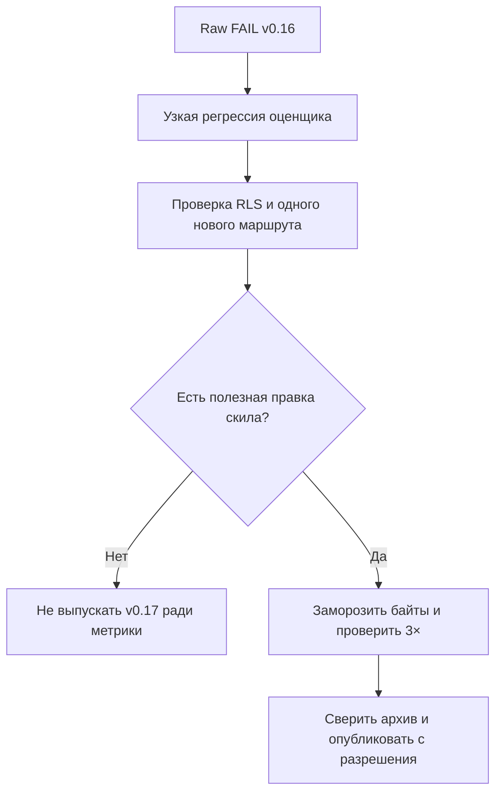

# План v0.17: точность оценки и устойчивость прикладных ответов

**Результат проверки v0.17:** native `gpt-6-luna` / medium 3×: activation — **10/11 majority, 30/33 GREEN**; guided — **27/27, 74/81**. Обе матрицы полные, fixture/isolation PASS, ложных активаций и запрещённых вызовов в GREEN нет. `neutral-form-caption` прошёл 3/3 без БСП. Платформенная регистрация обмена осталась 1/3 по качеству ответа при 0/3 активаций: в двух ответах неверный платформенный API. SHA-256 fingerprint проверенного скила: `30789a6822d2a31237d13f4b8d052b2e442c9e161ac67e19be8b6f71663d4462`. Сырые отчёты `v017-scope-narrow-{activation,guided}-luna-native-3x.json` сохранены локально в `.tmp/`.

**База:** [опубликованный v0.16](https://github.com/brake71/1c-ssl-skills/releases/tag/v0.16), commit `aa43038`. Оба скачанных архива побайтно совпали с Git-сборкой; skill fingerprint `a531b00ada743f832e159868c669c6d68ff120f2d0c2c4f0269141fca68e51d6`. Последняя [native sol-матрица](../reports/bsp-skills/p5-sol-full-matrix-after-limit-recovery.md): guided **27/27 majority, 80/81 individual**, activation **11/11, 32/33**; quality/fixture/isolation PASS. Это не результаты других моделей. Старая локальная [дорожная карта v0.16](bsp-development-after-v0.13.md) — история, а не release gate для v0.17.

**Цель:** улучшить проверяемую полезность скила, а не добиться 100% отдельных стохастических ответов или увеличить покрытие ради числа. Если после диагностики найдётся только правка оценщика без полезного изменения `skills/bsp/`, выпуск v0.17 отложить; исправление CI может выйти отдельно.

## Работы по порядку

1. **Guided false negative, `save-attached-file-public-boundary` #2.** Сохранённый ответ проверяет `Данные = Неопределено` после `РаботаСФайлами.ДвоичныеДанныеФайла(..., Ложь)`; regex допускает только `ДвоичныеДанные`/`ДанныеФайла`. Добавить paired positive/negative tests: принимать проверку именно переменной, полученной от этого вызова; отклонять несвязанную переменную, отсутствующий guard и ошибочный флаг/вызов. Не превращать старый raw FAIL в PASS и не менять пороги. Если отрицательные контроли не удаётся выразить надёжно — оставить FAIL и записать ограничение оценщика.
2. **RLS-отказ несмотря на чтение:** в [P3 raw-аудите](../reports/bsp-skills/p3-neutral-api-scope-activation-followup.md) `neutral-rls-field-message` #1 прочитал `users-access.md` и `base-common.md`, но не использовал `УправлениеДоступом.ЧтениеРазрешено(...)`. Сначала посмотреть фактические команды и фрагмент выдачи, затем проверить, помогает ли *локальное* изменение навигации/примера в `users-access.md` (при необходимости `base-common.md`), не переписывая весь reference. Подтвердить поведение по документации БСП 3.1.11 и `src/cf`, если меняется API-утверждение. Если материал уже ясен, не менять скил без гипотезы и негативного контроля.
3. **Один сценарий самостоятельной активации файлов:** проверить нейтральную задачу с присоединённым файлом, отсутствием данных и предложенным служебным методом, ориентируясь на существующий guided `save-attached-file-public-boundary`. Новый activation-case должен проверять открытие `files-and-versions.md`, публичный метод и безопасный guard; для границы scope использовать существующие platform-only negatives, новый добавлять только при иной выявленной ошибке. Синхронно обновить `evals/activation-reference-matrix.json`; 7/24 — возможный результат *при наличии осмысленного кейса*, не обязательная квота. Если кейс оказывается дублем или скил не требует правки — не включать его ради покрытия.
4. **Граница версии:** сохранить `other-version-api-boundary` #1 как individual FAIL: отказ выдать сигнатуру 3.2.1 был верен, но BSP не активирован. Проверить, нужна ли активация для этого вопроса по заданному продуктовому контракту, прежде чем менять `should_trigger` или router. Не выдавать сигнатуру 3.1.11 за 3.2.1. Если меняется ожидание — отдельные парные тесты и новая граница, не пересчёт истории.

**Вне объёма этой партии:** погоня за 24/24 activation references, исправление platform-only ответа активацией BSP, изменение `vendor/agents-best-practices`, универсальный BSL parser и замена детерминированного scorer общим LLM-judge. Платформенный negative остаётся: `forbidden_hits=0` без исключений.

## Проверка и решение о выпуске

- Одна проблема за раз: исходный raw → тест с позитивным и ошибочным вариантом → минимальная правка → targeted RED/GREEN. Для случая с реальной ошибкой ответа исправлять скил, не scorer; сохранять прежние FAIL и fingerprints.
- После **последней** правки скила, корпуса или оценщика: 232+ unit tests, coverage не ниже 664/664 и 24/24 reference-файлов, semantic ERROR/WARN 0/0, оба dry-run. Затем один frozen `gpt-6-luna` / medium native guided и activation 3× с внешним consumer, fixture/isolation и полным raw-разбором отдельных FAIL. При добавлении одного activation-кейса это **234 RED/GREEN попытки** (27 + 12 кейсов × 3 × 2) без учёта infrastructure recovery; предыдущая пара матриц потребовала порядка **17,9 млн input и 0,4 млн output tokens** по отчётам — заранее учитывать лимит. Восстанавливать только инфраструктурные слоты, не повторять quality ради PASS.
- Release gate: обе матрицы `complete=true`, majority/gates PASS, `forbidden_hits=0`, отрицательные сценарии без ложной активации, каждое заявленное reference прочитано, fixture/cleanup PASS. Individual FAIL не скрывать и не объявлять причинно исправленными из одного нового прогона. При gate FAIL остановиться, разобрать причину и отдельно решить, менять ли кандидат.
- Если есть существенное изменение скила и gate пройден: зафиксировать Git-дерево; собрать ZIP/tar.gz и сравнить **полный fingerprint/состав** с уже проверенным native payload и runner/corpora с отчётом. При совпадении байтов **не повторять** 3× из распакованного архива. После отдельного разрешения на tag/push/release проверить CI, описание и SHA-256 скачанных assets. Если байты или критерии не совпадают — вернуться к проверке на новой frozen границе.

**Готово, когда:** есть подтверждённая пользовательская польза от изменения `skills/bsp/`, зафиксированная новая матрица проходит указанные gates, архив подтверждает те же байты, а опубликованный release (только с разрешения) содержит идентичные скачанные файлы. Без полезной правки скила результат этой итерации — закрытый исследовательский/CI-долг, а не принудительный v0.17.
