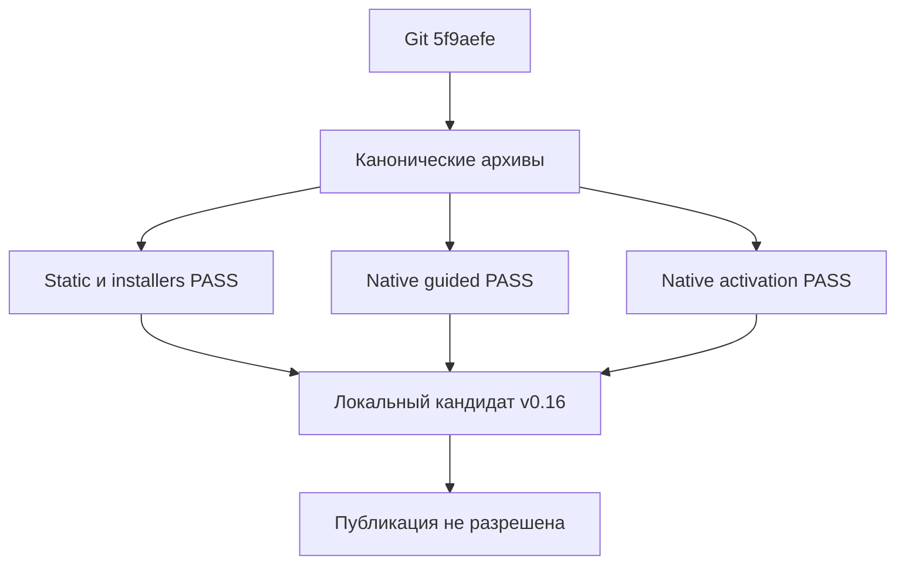

# v0.16: готовность локального кандидата без публикации

## Решение

Кандидат **v0.16** прошёл локальные static/packaging/installer проверки и
native gates на frozen **5f9aefe**: smoke, targeted RLS, полный guided 3× и
полный activation 3×. Это версия локальных архивов, **не Git-тег и не релиз**.
Tag, push, удалённый CI, публикация и проверка скачанных assets не выполнялись.

Activation: **10/10 majority, 28/30 individual**, не 30/30. Два quality FAIL
сохранены; coverage самостоятельной активации **5/24 references**, не все 24.
PASS порогов не гарантирует будущую безошибочность.

## Что изменено

- Первая партия activation: 6 → 10 сценариев, 2/24 → 5/24 references;
  public/service boundary, RLS, печать и сквозная задача с двумя references.
- `secondary_references` и schema 6: обязателен успешный reader каждого файла;
  listing и mixed-reader exit 1 не заменяют чтения.
- Исправлен хук возможных прав: имя, добавление строки, `Заголовок`, владелец
  и инициализация массивов. В печати отделены определение требуемой команды
  и отложенное формирование табличного документа.
- RLS-message: уточнены мягкий отказ и привязка к полю текущей формы без
  ключа проверяемой ссылки. Paired regressions защищают refusal branch,
  nested/outer false condition, неверный ключ и literal/comment effects.
- Устранены подтверждённые wording false negatives: Boolean access denial
  не маркирует API как запрещённый; конкретная эквивалентная формулировка
  неоднозначности ключа/пути принимается с negative controls.

Это не универсальный BSL interpreter: single-If/key guard относится к
засчитываемому fence, не ко всем фрагментам ответа; дополнительные условия
консервативно исключаются. Полная корректность типов/управления потоком не
доказана. Изменение evaluator/corpus задаёт новую границу сравнимости.

## Точные байты поставки

| Архив | SHA256 |
|---|---|
| `bsp-skill-v0.16.zip` | `721bbe6be87512cd112ab17ce5736ff453a77f8e3c2263c8a6011d42d976f879` |
| `bsp-skill-v0.16.tar.gz` | `df2d574282f1309ba631ac2e036dd53bd870c7b45bcf41f7978b001fec147427` |

Skill fingerprint:
`9e023a29d78053c2db4b9503f4b234455344e5bf9ce81363f6b1a26faf3a496d`.

Две сборки из `bdafb41`, затем две из `5f9aefe` дают те же точные архивы,
files/modes/fingerprint; отличаются source Git tree в manifests.
`5f9aefe` изменил только guided wording criterion/tests/report, не payload.
Внутри **29 файлов**: 27 в `skills/bsp` (24 references), `install.sh`,
`install.ps1`. Нет BSP sources/docs, vendor, evals/reports/tests, cache и auth.
Проверены actual ZIP/tar extraction, точные байты, полный список и modes
(включая `install.sh` 0755), packaged API help/compilation и обязательный `--src`.

Оба упакованных установщика, каждый архив и Claude/Codex/OpenCode:
**12 первых установок, 12 обновлений, 24 безопасных отказа**; явные scratch
paths с пробелами, unchanged sentinel skills, cleanup PASS. Network canaries
не сработали, global targets не использовались. Это Windows/Git Bash/PowerShell,
не реальные Linux/macOS или remote CI runs.

Последние static checks: **217 tests PASS**, API **664/664**, 24 references,
coverage 100%, semantic ERROR/WARN **0/0**. Оба dry-run проверили реально
извлечённый скил во внешнем consumer с явным native/model/effort.

## Свежий frozen native цикл

`native-runtime-v1`, schema 6, `gpt-6-luna`, medium, jobs 6, timeout 480.
Источник — реально извлечённый ZIP:
`.tmp/v0.16 message local tests/unpacked zip/skills/bsp`.
Отдельный consumer `C:/Users/dchekmenev/Projects/bsp-native-v016-consumer`:
без sources/docs БСП, neutral fixture, prospective ordinary manifests.
Zero-model preflight complete/catalog PASS не заменяет runtime inventory.

| Этап | RED majority / individual | GREEN majority / individual | Overall | Isolation |
|---|---|---|---|---|
| Smoke 1× | 0/1 · 0/1 | **1/1 · 1/1** | PASS | PASS |
| Targeted RLS 1× | 0/1 · 0/1 | **1/1 · 1/1** | PASS | PASS |
| Guided 3× | 4/27 · 11/81 | **27/27 · 81/81** | PASS | PASS |
| Activation 3×, одна infrastructure recovery | 3/10 · 8/30 | **10/10 · 28/30** | PASS | PASS |

| Individual GREEN evidence | Smoke | RLS | Guided | Activation |
|---|---|---|---|---|
| Positive activation | 1/1 | 1/1 | **78/78** | **21/21** |
| All required references successfully read | 1/1 | 1/1 (два файла) | **78/78** | **18/18** |
| False activation negatives | нет negatives | нет negatives | **0/3** | **0/9** |

Version-boundary scenario входит в positive activation, но не имеет
обязательного reference: поэтому activation/read denominators различаются.
Cross-topic трижды прочитал оба файла; primary-only read не засчитывался.
В итоговых фазах infrastructure/incomplete/process failures **0**; GREEN
invalid/unsafe/forbidden BSP calls **0**. Это не исполнение/компиляция BSL.

### Один capacity failure: оригинал сохранён

Исходный full activation на `5f9aefe` имел `complete=false`, overall FAIL:
`neutral-print-registration` GREEN #1 — «Selected model is at capacity».
Quality статистика завершённых случаев не подменяла этот инфраструктурный FAIL.

Parent проверил partial raw outcomes, error и fingerprints. В **отдельной
копии** возобновлена только эта одна попытка на прежних model/effort/criteria.
Все **59 завершённых outcomes и artifacts**, включая оба GREEN quality FAIL,
остались побайтно неизменными. Original report/fixture/log/artifacts сохранены.
Модель не менялась; quality retry и повторов до случайного PASS не было.
После восстановления проверены все итоговые gates, fingerprints,
consumer manifest до/после и cleanup. Final cohort: **226 outcomes**;
с учётом initial capacity failure — 227 попыток.

### Два оставшихся activation quality FAIL

1. `neutral-print-registration` GREEN #3: требуемые registration/flag/command
   code patterns PASS, activation/read PASS. Реальный текст говорит, что
   БСП вызывает менеджерские обработчики; caller wording regex не принял
   формулировку с точечными именами и связывающим текстом. Это оставшийся
   wording debt; ручной диагноз не меняет raw FAIL.
2. `neutral-platform-exchange-registration` GREEN #2: вместо требуемого
   `ПланыОбмена` ответ дал `РегистрацияИзменений.ЗарегистрироватьИзменения(...)`.
   BSP не активировался, но platform mechanism criterion не выполнен.
   Этот ответ не объявляется корректным только из-за отсутствия BSP calls.

## Независимое evidence и безопасность

Parent заново пересчитал **226** final scores/phase summaries, actual activation,
exact per-file reads и final responses из raw JSONL, без новых model calls.
Fingerprints соответствуют frozen inputs; inventories/PID/thread/turn binding
и post-cleanup RED проверены. Source auth bytes неизменны (сравнение в памяти),
ordinary manifests до/после одинаковы; текущие bytes подтверждают after.
Stage отсутствует, disposable private homes **0**.

Known-credential scans: final native **916 файлов**, packaging **510 файлов**,
исходный partial activation отдельно **243 файла**; в каждом **0 совпадений**.
Это поиск известных account credentials, не универсальный secret detector.
`isolation_gate` не включает ordinary fixture control автоматически:
его отдельно обеспечивали обвязка и parent, этот P0-долг остаётся открытым.

## Исторические FAIL и границы

Результаты не переписаны: [первый printing FAIL и branch fix](v0.16-initial-smoke-and-remediation.md),
[nested-condition gap и quota recovery](v0.16-nested-denial-remediation.md),
[RLS targeted FAIL, wrong key/scorer repair](v0.16-rls-targeted-failure.md),
[smoke wording FAIL](v0.16-smoke-wording-calibration.md).
B1 guided recovery сохранил 57 quality outcomes и повторил только 105 quota
failures; его 77/81 PASS не использован вместо новой матрицы на новом payload.
Источники первой партии: [evidence pilot](v0.16-activation-source-check.md).

Native результаты не распространяются на standard `exec`, другую модель,
БСП 3.2.1, все 24 самостоятельных маршрута или unassisted Windows behavior.
Guided и activation — отдельные корпуса, их метрики не суммируются в quality.
Новые PASS не доказывают изолированный причинный эффект одного изменения.
Пользовательский dirty `vendor/agents-best-practices` не изменён/не staged.

## Локальные артефакты

- `.tmp/v0.16-wording-{candidate,rebuild}/`: manifests, exact archives/extracted.
- `.tmp/v0.16-message-{candidate,rebuild}/` и `.tmp/v0.16 message local tests/`:
  original tested payload, real extraction и packaged installers.
- `.tmp/v0.16-message-local-packaging.json`, `-packaging-parent.json`.
- `.tmp/v0.16-wording-native-preflight.json`/`.log`.
- `.tmp/native-current-5f9aefe-{smoke,activation-rls-1x,guided-full-3x}.json`.
- `.tmp/native-current-5f9aefe-activation-full-3x.json`: original capacity FAIL.
- `.tmp/native-current-5f9aefe-activation-full-3x-capacity-resumed.json`: final.
- Соответствующие `-fixture.json`, `.log`, `-artifacts/`.
- `.tmp/native-current-5f9aefe-{activation-partial,capacity-final}-parent-verification.json`.
- `.tmp/v016-final-completed-{unit,coverage,semantic,guided-dry,activation-dry}.log`.

Окончательная документационная запись результата должна менять только docs.
Сборка из итогового Git ref обязана сохранить эти archive hashes/fingerprint.
Для tag/push/publication требуется отдельное разрешение; команда установки
по опубликованному ref в README остаётся на v0.15.
