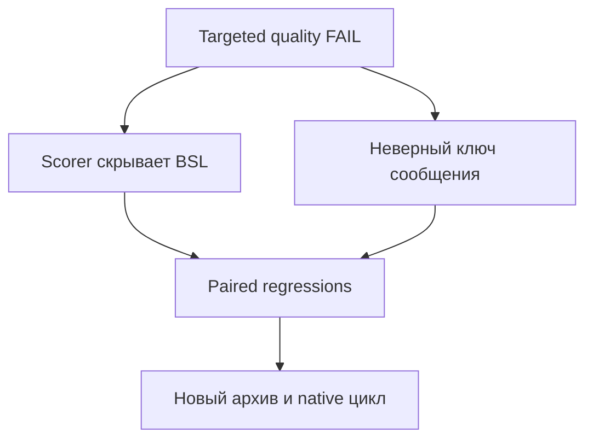

# v0.16: targeted RLS FAIL на 37378fa и отдельная коррекция

Frozen `37378fa`, `native-runtime-v1`, `gpt-6-luna`, medium, jobs 6,
timeout 480; реально распакованный ZIP второго кандидата. Targeted RLS:
RED 0/1, GREEN **0/1**, overall **FAIL**, isolation PASS. Обе обязательные
references успешно прочитаны; infrastructure/incomplete/process failures 0.
Полный activation 3× после FAIL не запускался, quality retry/resume не было.

Parent проверил raw responses, каждый reference, score/summary, fingerprints,
fixture/auth/inventory/cleanup. Receipt:
`.tmp/native-current-37378fa-resumed-final-parent-verification.json`;
known-credential scan 11 файлов, 0 совпадений. Original FAIL не пересчитан.

## Две разные причины

1. **Scorer false negative:** описание `ЧтениеРазрешено()` — «возвращает
   Ложь, если чтение ссылки запрещено» — считалось запретом самого API.
   Эвристика исключила весь fence, поэтому все code/syntax patterns
   отсутствовали, хотя BSL присутствовал. Минимальный дифференциальный
   replay оригинальной функции `warning_targets_same_call` из `37378fa`
   дал RED (`.tmp/v016-denied-description-original-code-red.log`).
   Исправление удаляет только этот явный predicate о Boolean-результате
   перед распознаванием запрета; независимое «вызывать запрещено»/«нельзя»
   сохраняет исключение. Это локальная грамматика, не общий NLP-анализ.
2. **Настоящая ошибка привязки:** ответ передал проверяемую ссылку
   `Объект.ДокументОснование` как `КлючДанных`, хотя сообщение требуется
   у поля текущей формы. Ключ относится к объекту сообщения — владельцу
   поля, а не к значению-ссылке внутри реквизита. Без исправления этой
   ошибки ответ не объявляется правильным после ремонта эвристики.

Документация `bsp3111_md/242_сообщитьпользователю.md` и комментарий/реализация
`ОбщегоНазначения.СообщитьПользователю` в исходнике БСП 3.1.11 подтверждают
различие ключа объекта и пути поля. Для этого сценария выбирается
документированный вариант без ключа, с полным именем поля и пятым `Отказ`.
В `base-common.md` уточнён выбор владельца поля; `users-access.md` направляет
к единому примеру мягкого отказа вместо дублирования кода.

## Regression boundary

Исходные raw artifacts сохранены неизменными. Текст ответа помещён в
`tests/fixtures/responses/v016-rls-wrong-message-key.md`; Git нормализует
окончания строк fixture в LF, не меняя содержимое. После ремонта
negative-context heuristic он по-прежнему FAIL: известные вызовы видны,
но проверяемая ссылка во втором аргументе не допускается засчитываемым
syntax fence. Замена только ошибочного ключа на пропущенный аргумент даёт
PASS. До guard новая регрессия падала (`.tmp/v016-message-key-red.log`).

Guard распознаёт наблюдаемый неправильный ключ после скалярного первого
аргумента или одного вложенного вызова, например `НСтр`. Это bounded
регрессия для выбранного ошибочного ответа, не универсальный разбор
аргументов/типов BSL и не доказательство правильности всех иных ключей.
Прежние positive variants, literal/comment masking, single-If boundary и
printing FAIL сохранены. Prompt, матрицы и пороги не менялись.

Независимое read-only ревью подтвердило трактовку источников и локальность
исправлений; воспроизведённых блокеров в этой границе не обнаружено.
Отдельно выполнены 16 paired activation unit tests; native ревью не заменяет.

После коррекции: **214 tests PASS**, API **664/664**, semantic ERROR/WARN
**0/0**, оба dry-run PASS. Логи `.tmp/v016-message-repair-*.log`.

Новая коррекция меняет **runner, activation corpus и payload**. Поэтому
предыдущий guided PASS на b1f21a0/37378fa сохраняется как отдельный результат,
но не переносится на новую поставку: требуются новая упаковка, проверки
обоих упакованных установщиков и новый frozen native цикл, включая полный
guided 3× и activation 3×. Tag/push/publication не выполнялись.
